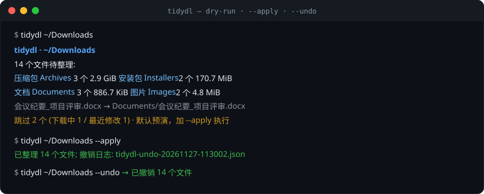

# tidydl

[](LICENSE)
[](pyproject.toml)
[-2da44e.svg)](pyproject.toml)

> **下载文件夹一键收拾:零配置分类整理,默认预演,全程可撤销。**



*One command to tidy your Downloads folder — zero-config rules, dry-run by default, fully undoable.* 零第三方依赖,Windows / Linux / macOS 通用。

## 为什么需要它

下载文件夹是每台电脑里回收最快的垃圾场:截图、安装包、课件、压缩包、视频全堆在顶层。想收拾,又怕误动正在下载的文件、怕整理错了回不来。

现有方案各有门槛:

| 方案 | 问题 |
|---|---|
| organize-tool 等规则引擎 | 要先写 YAML 配置,不配置不动手 |
| 常驻自动整理守护(如 [mouzi](https://github.com/hsr88/mouzi)) | 后台服务,需要信任与安装,黑盒感强 |
| GUI 整理软件 | 闭源、捆绑、广告的不少 |

tidydl 的立场:**按需一条命令、零配置、默认只预演、错了随时撤销。**

## 快速开始

一行命令直接安装或试用（零第三方依赖）：

```console
# 推荐: pipx 隔离安装
$ pipx install git+https://github.com/heht24-cyber/tidydl.git

# 或通过 uvx 免安装直接预演
$ uvx --from git+https://github.com/heht24-cyber/tidydl.git tidydl

# 或直接使用 pip 安装
$ pip install git+https://github.com/heht24-cyber/tidydl.git

$ tidydl
```

真实运行输出(预演 → 执行 → 撤销):

```console
$ tidydl D:\tmp\demo-downloads
tidydl · D:\tmp\demo-downloads
  14 个文件待整理:
    压缩包 Archives        3 个     2.9 GiB
    音频 Audio           2 个    79.2 MiB
    代码 Code            1 个     2.3 KiB
    文档 Documents       3 个   886.7 KiB
    图片 Images          2 个     4.8 MiB
    安装包 Installers      2 个   170.7 MiB
    视频 Videos          1 个   457.8 MiB
      bilibili_video_8848.mkv → Videos\bilibili_video_8848.mkv
      IMG_20261112_193004.jpg → Images\IMG_20261112_193004.jpg
      会议纪要_项目评审.docx → Documents\会议纪要_项目评审.docx
      ubuntu-24.04.3-desktop-amd64.iso → Archives\ubuntu-24.04.3-desktop-amd64.iso
      …(其余 10 个略)
  跳过 2 个(下载中 1 / 最近修改 1)

  预演模式:确认无误后加 --apply 执行;执行后 --undo 可一键撤销。

$ tidydl D:\tmp\demo-downloads --apply
  已整理 14 个文件;撤销日志:tidydl-undo-20261127-113002.json

$ tidydl D:\tmp\demo-downloads --undo
已撤销 14 个文件(依据 tidydl-undo-20261127-113002.json)
```

同一秒内执行多批整理会分别保留日志。只想撤销某一批时，可以从任意目录运行 `tidydl --undo "日志文件的完整路径"`。如果整理因文件移动错误而中断，已成功移动的文件也会记录在该批日志中。

连续运行 `tidydl --undo` 会从新到旧逐批还原。每还原一条记录，工具就会在该批日志中记下进度。再次指定已完成的日志会显示还原 0 个文件，即使同名新文件已经整理到同一位置。若撤销中途遇到文件占用等错误，解除占用后可再次运行。旧版已使用过的日志没有保存当时的进度，升级前撤销过的旧日志请勿重放。

## 安全设计

- **默认预演**:不加参数只打印计划,`--apply` 才真正动文件
- **可撤销**:每次执行写撤销日志,`--undo` 一键还原;原位置已有同名新文件时两边都保留
- **不碰正在下载的文件**:`.crdownload` / `.part` / `.opdownload` / `.!qB` 一律跳过;默认 10 分钟内修改过的文件也跳过(`--min-age` 可调,0 = 不跳)
- **只移动、永不删除**:分类进子文件夹,不删任何东西
- **不递归**:只整理目录顶层(下载文件夹通常是平的),防止意外波及子目录

## 内置分类

图片 / 视频 / 音频 / 文档 / 压缩包 / **安装包(单独一类,下载文件夹的大头)** / 代码 / 字体 / 其他,覆盖 100+ 常见扩展名,`tidydl --list-rules` 查看全表。

自定义规则(与内置合并,**同名扩展名以你的为准**):

```json
{"Images": ["avif"], "设计稿": ["psd", "sketch"]}
```

```console
$ tidydl --rules my.json
```

## 局限(v0.1)

- 按扩展名分类,不看文件内容
- Windows 下默认整理 `~/Downloads`(下载目录重定向过的用位置参数指定)

## 开发与测试

```console
$ python -m unittest discover -s tests -v
```

测试覆盖分类、跳过规则、防撞改名、分批整理与撤销、中断恢复、旧日志兼容、幂等重跑、自定义规则和 CLI 退出码。

## License

MIT
